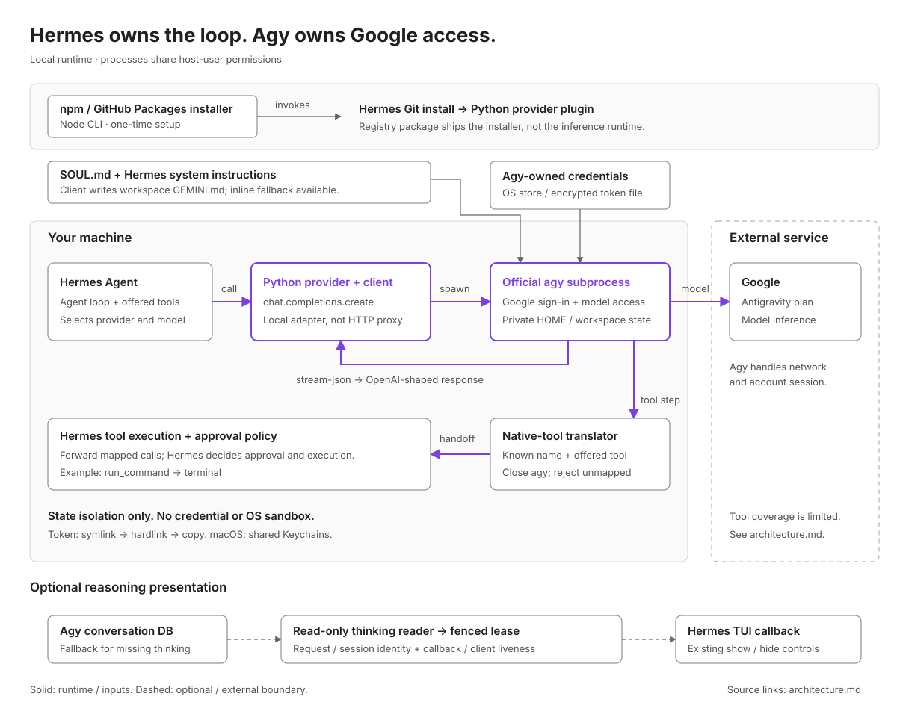

# Architecture

Hermes runs the agent loop; the Python plugin adapts model calls to Google's official `agy` subprocess. Agy owns Google sign-in and network access. Mapped tool calls return to Hermes for execution.

*Solid arrows show the runtime path and supporting inputs. Dashed arrows show optional reasoning delivery. The installer is a separate, one-time lane.*

## Follow a request

| Stage | What happens | Source |
|---|---|---|
| Install | The npm or GitHub Packages CLI invokes `hermes plugins install` against this Git repository. The registry package is a Node installer, not the Python runtime. | [`package.json`](../package.json#L5-L15), [`bin/cli.js`](../bin/cli.js#L66-L87) |
| Select | Hermes discovers the `antigravity-oauth` provider, whose `external_process` profile creates `AntigravityClient`. Its `chat.completions.create` interface is OpenAI-shaped; `agy://local` is a marker, not an HTTP endpoint. | [`__init__.py`](../__init__.py#L73-L80), [profile](../__init__.py#L267-L287), [`client.py`](../client.py#L250-L266) |
| Prepare | The client writes SOUL and system instructions to workspace `GEMINI.md`. Changed rules retire the worker; disabled rules or a write failure fall back to inline instructions. | [`client.py`](../client.py#L456-L475), [`soul.py`](../soul.py#L21-L78) |
| Call | The client launches or reuses an agy worker, or launches a one-shot subprocess. It sends prompts on stdin and consumes stream-json stdout. Agy makes the Google model request with its existing session. | [`client.py`](../client.py#L477-L576) |
| Return | `AntigravityStream` produces OpenAI-shaped chunks. Non-streaming callers receive a collected completion, including tool calls, reasoning and usage when available. | [`stream.py`](../stream.py#L1130-L1217) |

## Credentials: shared access, separate state

The private HOME separates agy's workspace and session state. **It is not a credential sandbox or an OS sandbox.** The subprocess still runs as the host user.

When an encrypted token file exists, the plugin exposes it inside that HOME via **symlink → hardlink → `copy2` fallback**. The plugin does not decrypt or parse its contents, but the fallback can copy the encrypted file. On macOS it also links the user's actual `~/Library/Keychains`, unless an explicit `ANTIGRAVITY_CONFIG_DIR` overrides that route. See [`process.py`](../process.py#L506-L596).

Local auth probes check file metadata or OS credential-store metadata. On Linux, `secret-tool search` itself loads secrets; the plugin discards stdout and inspects stderr metadata. This is narrower than a claim that no process ever reads credentials ([probe explanation](../process.py#L194-L202), [implementation](../process.py#L305-L315)). Client close terminates children before best-effort workspace cleanup; it does not revoke agy's account session ([`client.py`](../client.py#L337-L365)).

`hermes auth add antigravity-oauth` delegates login to agy with a one-word model prompt, so sign-in can consume a model turn. Logout only prints agy's `/logout` instructions; it does not sign out on your behalf ([`auth.py`](../auth.py#L25-L37), [logout](../auth.py#L119-L127)).

## Tools: translate, then hand back to Hermes

For native `step_update` tool events, the stream asks the translator for a Hermes tool-call delta, then closes the agy process. If translation fails, it closes the process without forwarding that call ([`stream.py`](../stream.py#L695-L723)).

Translation requires a known native name, an offered Hermes tool, valid arguments, and full parameters if the event preview was truncated ([`native_tools.py`](../native_tools.py#L169-L192)). Current mappings are:

| Agy native name | Hermes tool |
|---|---|
| `run_command` | `terminal` |
| `view_file` | `read_file` |
| `write_to_file` | `write_file` |
| `grep_search`, `find_by_name` | `search_files` |
| `search_web` | `web_search` |
| `read_url_content` | `web_extract` |

The [mapping table](../native_tools.py#L89-L98) defines support, not every tool agy may expose. Hermes executes forwarded calls under its own tool and approval policy. Event interception is not proof of universal native-tool denial: agy 1.4+ renamed file tools that are not bridged yet ([#19](https://github.com/neerazz/hermes-antigravity-oauth/issues/19)). Do not treat the temporary HOME as host-access containment.

## Optional reasoning presentation

Where stream reasoning is unavailable, a request-scoped reader can inspect agy's conversation SQLite DB in **read-only** mode ([`thinking.py`](../thinking.py#L86-L103)). A fenced, single-collector lease permits compatible non-streaming foreground turns to deliver reasoning to the existing Hermes TUI callback; it checks request/session identity and client liveness. It changes neither authentication nor tool execution. See [reasoning delivery and compatibility](internals.md#live-reasoning-on-non-streaming-hermes-turns) and [`live_reasoning.py`](../live_reasoning.py#L60-L170).

For model IDs, effort flags and context metadata, continue to [Internals](internals.md). For installation, return to the [README](../README.md).
